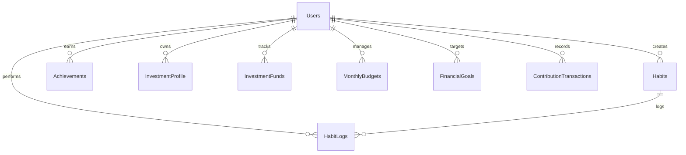

# Habit Hero - Google Sheets Database Schema

This document details the Google Sheets layout designed to serve as our relational database. We define four sheets: `Users`, `Habits`, `HabitLogs`, and `Achievements`.

---

## 1. Sheet: `Users`
Stores user profile information, authentication credentials, and overall gamification stats.

| Column Name | Data Type | Key Type | Description | Example Value |
| :--- | :--- | :--- | :--- | :--- |
| **UserID** | String (UUID) | Primary Key | Unique identifier for each user | `usr_l8p2m9q5` |
| **Name** | String | - | Display name of the user | `Alex Mercer` |
| **Email** | String | Unique Index | Email address (used to log in) | `alex@habithero.com` |
| **Password** | String (Hash) | - | Securely stored password for auth | `bcrypt_hash_or_plaintext` |
| **JoinDate** | Date (YYYY-MM-DD) | - | Timestamp when account was created | `2026-06-01` |
| **XP** | Number | - | Total accumulated experience points | `350` |
| **Level** | Number | - | Calculated level (derived from XP) | `3` |
| **Streak** | Number | - | Current consecutive days active | `7` |
| **LongestStreak** | Number | - | Historical maximum streak achieved | `14` |

---

## 2. Sheet: `Habits`
Stores habit definitions configured by users.

| Column Name | Data Type | Key Type | Description | Example Value |
| :--- | :--- | :--- | :--- | :--- |
| **HabitID** | String (UUID) | Primary Key | Unique identifier for the habit | `hab_k3j1n4h2` |
| **UserID** | String (UUID) | Foreign Key | Owner of the habit (references `Users.UserID`) | `usr_l8p2m9q5` |
| **HabitName** | String | - | Name of the habit | `Morning Run` |
| **Description** | String | - | Purpose or short description of the habit | `Run 3km in the park` |
| **Category** | String | - | Habit category (`Gym`, `Reading`, `Coding`) | `Gym` |
| **XPReward** | Number | - | Experience points rewarded on check-in | `10` |
| **Status** | String | - | Current state (`Active` or `Inactive`) | `Active` |

---

## 3. Sheet: `HabitLogs`
Tracks daily completions of habits.

| Column Name | Data Type | Key Type | Description | Example Value |
| :--- | :--- | :--- | :--- | :--- |
| **LogID** | String (UUID) | Primary Key | Unique identifier for the log entry | `log_z8x9c0v1` |
| **HabitID** | String (UUID) | Foreign Key | The habit logged (references `Habits.HabitID`) | `hab_k3j1n4h2` |
| **UserID** | String (UUID) | Foreign Key | User who logged it (references `Users.UserID`) | `usr_l8p2m9q5` |
| **Date** | Date (YYYY-MM-DD) | - | Date of check-in | `2026-06-01` |
| **Completed** | Boolean | - | Success state (`TRUE` = Completed, `FALSE` = Missed) | `TRUE` |

---

## 4. Sheet: `Achievements`
Stores badges and trophies unlocked by users.

| Column Name | Data Type | Key Type | Description | Example Value |
| :--- | :--- | :--- | :--- | :--- |
| **AchievementID** | String (UUID) | Primary Key | Unique achievement record identifier | `ach_v9b8n7m6` |
| **UserID** | String (UUID) | Foreign Key | Recipient of the badge (references `Users.UserID`) | `usr_l8p2m9q5` |
| **BadgeName** | String | - | Name of the badge unlocked | `7 Day Streak` |
| **UnlockedDate** | Date (YYYY-MM-DD) | - | Timestamp when achievement criteria were met | `2026-06-01` |

---

## 5. Sheet: `InvestmentProfile`
Stores baseline user-reported financial figures, income planning ranges, and liquid assets.

| Column Name | Data Type | Key Type | Description | Example Value |
| :--- | :--- | :--- | :--- | :--- |
| **UserID** | String (UUID) | Primary Key | User reference | `usr_vishu` |
| **MonthlyIncomeMin** | Number | - | Lower bound of monthly income planning | `60000` |
| **MonthlyIncomeMax** | Number | - | Upper bound of monthly income planning | `80000` |
| **BankSavings** | Number | - | Reported bank savings | `200000` |
| **MutualFundHoldings** | Number | - | Reported mutual fund portfolio value | `170000` |
| **EmergencyFundBalance**| Number | - | Current emergency allocation | `80000` |
| **HouseFundBalance** | Number | - | Current house fund allocation | `70000` |
| **DaughterFundBalance** | Number | - | Current child future allocation | `50000` |
| **MonthlySavingsTarget**| Number | - | Monthly savings goal target | `20000` |
| **LastUpdated** | Date (YYYY-MM-DD) | - | Timestamp of last baseline update | `2026-10-27` |

---

## 6. Sheet: `InvestmentFunds`
Stores reference mutual fund allocation blueprint and active SIP commitments.

| Column Name | Data Type | Key Type | Description | Example Value |
| :--- | :--- | :--- | :--- | :--- |
| **FundID** | String (UUID) | Primary Key | Unique identifier for the fund | `fund_sbi_small` |
| **UserID** | String (UUID) | Foreign Key | Owner of the record | `usr_vishu` |
| **Name** | String | - | Name of the mutual fund | `SBI Small Cap` |
| **Category** | String | - | Asset class category | `Small Cap` |
| **ReferenceSIP** | Number | - | Reference blueprint monthly SIP amount | `2000` |
| **ActiveSIP** | Number | - | Active committed auto-debit SIP | `3000` |
| **ActualThisMonth** | Number | - | Actual deposit this month | `3000` |
| **Status** | String | - | `Active` or `On Hold` | `Active` |
| **Instruction** | String | - | Operating directive | `Continue existing SBI SIP at ₹3,000` |

---

## 7. Sheet: `MonthlyBudgets`
Tracks monthly categorized cash flow, fixed living expenses, insurance provisions, and actual savings.

| Column Name | Data Type | Key Type | Description | Example Value |
| :--- | :--- | :--- | :--- | :--- |
| **BudgetID** | String (UUID) | Primary Key | Budget unique identifier | `bgt_2026-10` |
| **UserID** | String (UUID) | Foreign Key | Owner of the budget | `usr_vishu` |
| **MonthYear** | String (YYYY-MM) | Unique Index | Target month | `2026-10` |
| **SalaryIncome** | Number | - | Actual salary received | `65000` |
| **TrainingFreelanceIncome** | Number | - | Confirmed training / client income | `10000` |
| **OtherIncome** | Number | - | Other income | `0` |
| **Rent** | Number | - | Fixed monthly rent | `10500` |
| **Groceries** | Number | - | Monthly provisions (₹10k–15k range) | `12500` |
| **ParentsSupport** | Number | - | Family support allocation | `3000` |
| **Utilities** | Number | - | Electricity, internet, bills | `2500` |
| **Transport** | Number | - | Commute and fuel | `2000` |
| **TermInsuranceMonthly** | Number | - | Monthly accrual for ₹24,000/yr term policy | `2000` |
| **HealthInsuranceMonthly**| Number | - | Monthly accrual for ₹19,000/yr health policy | `1583` |
| **Healthcare** | Number | - | Medical expenses | `1000` |
| **OtherExpenses** | Number | - | Miscellaneous living expenses | `1500` |
| **ActualInvestments** | Number | - | Actual mutual fund contributions (SBI SIP) | `3000` |
| **EmergencySavings** | Number | - | Monthly emergency buffer deposit | `5000` |
| **HouseSavings** | Number | - | Monthly house purchase deposit | `5000` |
| **DaughterSavings** | Number | - | Monthly child future deposit | `5000` |
| **Notes** | String | - | Monthly summary notes | `Baseline monthly allocation` |

---

## 8. Sheet: `FinancialGoals`
Configurable financial targets with deadlines, milestone values, and progress.

| Column Name | Data Type | Key Type | Description | Example Value |
| :--- | :--- | :--- | :--- | :--- |
| **GoalID** | String (UUID) | Primary Key | Unique goal identifier | `goal_house` |
| **UserID** | String (UUID) | Foreign Key | Goal owner | `usr_vishu` |
| **Name** | String | - | Name of goal | `House Purchase 2033 (₹50 Lakh Target)` |
| **Category** | String | - | Goal category | `Real Estate` |
| **TargetAmount** | Number | - | Total target amount | `5000000` |
| **DownPaymentTarget** | Number | - | Intended cash down payment | `1500000` |
| **RegistrationCosts** | Number | - | Registration & Stamp Duty | `400000` |
| **CurrentBalance** | Number | - | Current allocated balance | `70000` |
| **MonthlyTarget** | Number | - | Planned monthly deposit | `15000` |
| **StartDate** | Date (YYYY-MM-DD) | - | Initiation date | `2026-01-01` |
| **Deadline** | Date (YYYY-MM-DD) | - | Target achievement date | `2033-12-31` |
| **Priority** | String | - | `Critical`, `High`, `Medium`, `Low` | `High` |
| **Status** | String | - | `In progress`, `On track`, `At risk`, etc. | `In progress` |
| **Notes** | String | - | Context and strategy notes | `Down payment ₹15L prioritized first` |

---

## 9. Sheet: `ContributionTransactions`
Audit trail of actual investments and savings deposits.

| Column Name | Data Type | Key Type | Description | Example Value |
| :--- | :--- | :--- | :--- | :--- |
| **TransactionID** | String (UUID) | Primary Key | Transaction identifier | `tx_87f2b1` |
| **UserID** | String (UUID) | Foreign Key | User reference | `usr_vishu` |
| **Date** | Date (YYYY-MM-DD) | - | Date of transaction | `2026-10-27` |
| **Category** | String | - | Category of deposit | `Mutual Fund` |
| **EntityName** | String | - | Destination entity / fund | `SBI Small Cap Active SIP` |
| **Amount** | Number | - | Amount deposited | `3000` |
| **Type** | String | - | `SIP`, `Lumpsum`, `Savings` | `SIP` |
| **PaymentMode** | String | - | `Auto-Debit`, `Bank Transfer`, `UPI` | `Auto-Debit` |
| **Notes** | String | - | Memo | `Monthly recurring SIP` |

---

## Relationships & Integrity Rules

1. **Cascade Deletes**: If a user is deleted, their habits, logs, achievements, financial profiles, and goals should be deleted.
2. **Uniqueness Rules**:
   - `Users.Email` must be unique.
   - For `HabitLogs`, the combination of `(HabitID, UserID, Date)` must be unique.
   - For `MonthlyBudgets`, the combination of `(UserID, MonthYear)` must be unique.

