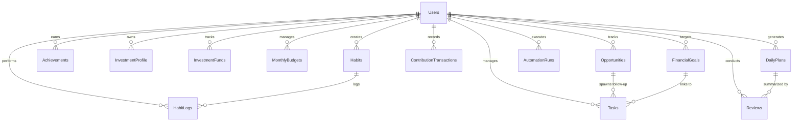

# Habit Hero - Google Sheets Database Schema

This document details the Google Sheets layout designed to serve as our relational database. We define four sheets: `Users`, `Habits`, `HabitLogs`, and `Achievements`.

---

## 1. Sheet: `Users`
Stores user profile information, authentication credentials, and overall gamification stats.

| Column Name | Data Type | Key Type | Description | Example Value |
| :--- | :--- | :--- | :--- | :--- |
| **UserID** | String (UUID) | Primary Key | Unique identifier for each user | `usr_l8p2m9q5` |
| **Name** | String | - | Display name of the user | `Alex Mercer` |
| **Email** | String | Unique Index | Email address (used to log in) | `alex@habithero.com` |
| **Password** | String (Hash) | - | Securely stored password for auth | `bcrypt_hash_or_plaintext` |
| **JoinDate** | Date (YYYY-MM-DD) | - | Timestamp when account was created | `2026-06-01` |
| **XP** | Number | - | Total accumulated experience points | `350` |
| **Level** | Number | - | Calculated level (derived from XP) | `3` |
| **Streak** | Number | - | Current consecutive days active | `7` |
| **LongestStreak** | Number | - | Historical maximum streak achieved | `14` |

---

## 2. Sheet: `Habits`
Stores habit definitions configured by users.

| Column Name | Data Type | Key Type | Description | Example Value |
| :--- | :--- | :--- | :--- | :--- |
| **HabitID** | String (UUID) | Primary Key | Unique identifier for the habit | `hab_k3j1n4h2` |
| **UserID** | String (UUID) | Foreign Key | Owner of the habit (references `Users.UserID`) | `usr_l8p2m9q5` |
| **HabitName** | String | - | Name of the habit | `Morning Run` |
| **Description** | String | - | Purpose or short description of the habit | `Run 3km in the park` |
| **Category** | String | - | Habit category (`Gym`, `Reading`, `Coding`) | `Gym` |
| **XPReward** | Number | - | Experience points rewarded on check-in | `10` |
| **Status** | String | - | Current state (`Active` or `Inactive`) | `Active` |

---

## 3. Sheet: `HabitLogs`
Tracks daily completions of habits.

| Column Name | Data Type | Key Type | Description | Example Value |
| :--- | :--- | :--- | :--- | :--- |
| **LogID** | String (UUID) | Primary Key | Unique identifier for the log entry | `log_z8x9c0v1` |
| **HabitID** | String (UUID) | Foreign Key | The habit logged (references `Habits.HabitID`) | `hab_k3j1n4h2` |
| **UserID** | String (UUID) | Foreign Key | User who logged it (references `Users.UserID`) | `usr_l8p2m9q5` |
| **Date** | Date (YYYY-MM-DD) | - | Date of check-in | `2026-06-01` |
| **Completed** | Boolean | - | Success state (`TRUE` = Completed, `FALSE` = Missed) | `TRUE` |

---

## 4. Sheet: `Achievements`
Stores badges and trophies unlocked by users.

| Column Name | Data Type | Key Type | Description | Example Value |
| :--- | :--- | :--- | :--- | :--- |
| **AchievementID** | String (UUID) | Primary Key | Unique achievement record identifier | `ach_v9b8n7m6` |
| **UserID** | String (UUID) | Foreign Key | Recipient of the badge (references `Users.UserID`) | `usr_l8p2m9q5` |
| **BadgeName** | String | - | Name of the badge unlocked | `7 Day Streak` |
| **UnlockedDate** | Date (YYYY-MM-DD) | - | Timestamp when achievement criteria were met | `2026-06-01` |

---

## 5. Sheet: `InvestmentProfile`
Stores baseline user-reported financial figures, income planning ranges, and liquid assets.

| Column Name | Data Type | Key Type | Description | Example Value |
| :--- | :--- | :--- | :--- | :--- |
| **UserID** | String (UUID) | Primary Key | User reference | `usr_vishu` |
| **MonthlyIncomeMin** | Number | - | Lower bound of monthly income planning | `60000` |
| **MonthlyIncomeMax** | Number | - | Upper bound of monthly income planning | `80000` |
| **BankSavings** | Number | - | Reported bank savings | `200000` |
| **MutualFundHoldings** | Number | - | Reported mutual fund portfolio value | `170000` |
| **EmergencyFundBalance**| Number | - | Current emergency allocation | `80000` |
| **HouseFundBalance** | Number | - | Current house fund allocation | `70000` |
| **DaughterFundBalance** | Number | - | Current child future allocation | `50000` |
| **MonthlySavingsTarget**| Number | - | Monthly savings goal target | `20000` |
| **LastUpdated** | Date (YYYY-MM-DD) | - | Timestamp of last baseline update | `2026-10-27` |

---

## 6. Sheet: `InvestmentFunds`
Stores reference mutual fund allocation blueprint and active SIP commitments.

| Column Name | Data Type | Key Type | Description | Example Value |
| :--- | :--- | :--- | :--- | :--- |
| **FundID** | String (UUID) | Primary Key | Unique identifier for the fund | `fund_sbi_small` |
| **UserID** | String (UUID) | Foreign Key | Owner of the record | `usr_vishu` |
| **Name** | String | - | Name of the mutual fund | `SBI Small Cap` |
| **Category** | String | - | Asset class category | `Small Cap` |
| **ReferenceSIP** | Number | - | Reference blueprint monthly SIP amount | `2000` |
| **ActiveSIP** | Number | - | Active committed auto-debit SIP | `3000` |
| **ActualThisMonth** | Number | - | Actual deposit this month | `3000` |
| **Status** | String | - | `Active` or `On Hold` | `Active` |
| **Instruction** | String | - | Operating directive | `Continue existing SBI SIP at ₹3,000` |

---

## 7. Sheet: `MonthlyBudgets`
Tracks monthly categorized cash flow, fixed living expenses, insurance provisions, and actual savings.

| Column Name | Data Type | Key Type | Description | Example Value |
| :--- | :--- | :--- | :--- | :--- |
| **BudgetID** | String (UUID) | Primary Key | Budget unique identifier | `bgt_2026-10` |
| **UserID** | String (UUID) | Foreign Key | Owner of the budget | `usr_vishu` |
| **MonthYear** | String (YYYY-MM) | Unique Index | Target month | `2026-10` |
| **SalaryIncome** | Number | - | Actual salary received | `65000` |
| **TrainingFreelanceIncome** | Number | - | Confirmed training / client income | `10000` |
| **OtherIncome** | Number | - | Other income | `0` |
| **Rent** | Number | - | Fixed monthly rent | `10500` |
| **Groceries** | Number | - | Monthly provisions (₹10k–15k range) | `12500` |
| **ParentsSupport** | Number | - | Family support allocation | `3000` |
| **Utilities** | Number | - | Electricity, internet, bills | `2500` |
| **Transport** | Number | - | Commute and fuel | `2000` |
| **TermInsuranceMonthly** | Number | - | Monthly accrual for ₹24,000/yr term policy | `2000` |
| **HealthInsuranceMonthly**| Number | - | Monthly accrual for ₹19,000/yr health policy | `1583` |
| **Healthcare** | Number | - | Medical expenses | `1000` |
| **OtherExpenses** | Number | - | Miscellaneous living expenses | `1500` |
| **ActualInvestments** | Number | - | Actual mutual fund contributions (SBI SIP) | `3000` |
| **EmergencySavings** | Number | - | Monthly emergency buffer deposit | `5000` |
| **HouseSavings** | Number | - | Monthly house purchase deposit | `5000` |
| **DaughterSavings** | Number | - | Monthly child future deposit | `5000` |
| **Notes** | String | - | Monthly summary notes | `Baseline monthly allocation` |

---

## 8. Sheet: `FinancialGoals`
Configurable financial targets with deadlines, milestone values, and progress.

| Column Name | Data Type | Key Type | Description | Example Value |
| :--- | :--- | :--- | :--- | :--- |
| **GoalID** | String (UUID) | Primary Key | Unique goal identifier | `goal_house` |
| **UserID** | String (UUID) | Foreign Key | Goal owner | `usr_vishu` |
| **Name** | String | - | Name of goal | `House Purchase 2033 (₹50 Lakh Target)` |
| **Category** | String | - | Goal category | `Real Estate` |
| **TargetAmount** | Number | - | Total target amount | `5000000` |
| **DownPaymentTarget** | Number | - | Intended cash down payment | `1500000` |
| **RegistrationCosts** | Number | - | Registration & Stamp Duty | `400000` |
| **CurrentBalance** | Number | - | Current allocated balance | `70000` |
| **MonthlyTarget** | Number | - | Planned monthly deposit | `15000` |
| **StartDate** | Date (YYYY-MM-DD) | - | Initiation date | `2026-01-01` |
| **Deadline** | Date (YYYY-MM-DD) | - | Target achievement date | `2033-12-31` |
| **Priority** | String | - | `Critical`, `High`, `Medium`, `Low` | `High` |
| **Status** | String | - | `In progress`, `On track`, `At risk`, etc. | `In progress` |
| **Notes** | String | - | Context and strategy notes | `Down payment ₹15L prioritized first` |

---

## 9. Sheet: `ContributionTransactions`
Audit trail of actual investments and savings deposits.

| Column Name | Data Type | Key Type | Description | Example Value |
| :--- | :--- | :--- | :--- | :--- |
| **TransactionID** | String (UUID) | Primary Key | Transaction identifier | `tx_87f2b1` |
| **UserID** | String (UUID) | Foreign Key | User reference | `usr_vishu` |
| **Date** | Date (YYYY-MM-DD) | - | Date of transaction | `2026-10-27` |
| **Category** | String | - | Category of deposit | `Mutual Fund` |
| **EntityName** | String | - | Destination entity / fund | `SBI Small Cap Active SIP` |
| **Amount** | Number | - | Amount deposited | `3000` |
| **Type** | String | - | `SIP`, `Lumpsum`, `Savings` | `SIP` |
| **PaymentMode** | String | - | `Auto-Debit`, `Bank Transfer`, `UPI` | `Auto-Debit` |
| **Notes** | String | - | Memo | `Monthly recurring SIP` |

---

## 10. Sheet: `Tasks`
Consolidates one-time tasks, recurring tasks, and milestone deliverables across all career, business, and personal areas.

| Column Name | Data Type | Key Type | Description | Example Value |
| :--- | :--- | :--- | :--- | :--- |
| **TaskID** | String (UUID) | Primary Key | Unique task identifier | `tsk_8m2k1p4` |
| **UserID** | String (UUID) | Foreign Key | Owner of the task (references `Users.UserID`) | `usr_vishu` |
| **Title** | String | - | Task title / actionable headline | `Build Lead Qualification Workflow` |
| **Description** | String | - | Detailed task description | `Implement tool-calling chain for CRM leads` |
| **Category** | String | - | Life / Business domain | `AI Agent Dev` |
| **ProjectArea** | String | - | Specific project or focus area | `AI CRM Agent` |
| **LinkedGoalID** | String (UUID) | Foreign Key | Optional reference to `FinancialGoals.GoalID` or milestone | `goal_house` |
| **LinkedOpportunityID** | String (UUID) | Foreign Key | Optional reference to `Opportunities.OpportunityID` | `opp_9k2m1a` |
| **Priority** | String | - | Initial band (`Critical`, `High`, `Medium`, `Low`) | `High` |
| **Status** | String | - | State (`Inbox`, `Planned`, `In Progress`, `Blocked`, `Completed`, `Deferred`, `Cancelled`) | `In Progress` |
| **EstimatedDuration** | Number | - | Estimated minutes to complete | `60` |
| **ActualDuration** | Number | - | Tracked minutes spent | `45` |
| **StartDate** | Date (YYYY-MM-DD) | - | Target start date | `2026-10-28` |
| **DueDate** | Date (YYYY-MM-DD) | - | Target completion deadline | `2026-10-29` |
| **DeadlineType** | String | - | `Hard`, `Soft`, or `Flexible` | `Hard` |
| **Dependencies** | String | - | Dependent task IDs or blockers | `tsk_setup_db` |
| **IncomeImpact** | String | - | `High`, `Medium`, `Low`, or `None` | `High` |
| **Importance** | Number | - | 0 to 100 importance score | `85` |
| **Urgency** | Number | - | 0 to 100 urgency score | `80` |
| **Readiness** | Number | - | 0 to 100 execution readiness | `100` |
| **NextAction** | String | - | Single concrete next physical step | `Write the prompt schema in zod` |
| **Recurrence** | String | - | `None`, `Daily`, `Weekly`, `Monthly` | `None` |
| **Source** | String | - | Origin (`Internal`, `GoogleTasks`, `Manual`) | `Internal` |
| **ExternalID** | String | - | External integration ID | `` |
| **CreatedAt** | String (ISO) | - | Record creation timestamp | `2026-10-28T08:00:00.000Z` |
| **UpdatedAt** | String (ISO) | - | Last modification timestamp | `2026-10-28T09:30:00.000Z` |
| **CompletedAt** | String (ISO) | - | Completion timestamp | `` |

---

---

## 11. Sheet: `DailyPlans`
Stores the daily Big 5 selections, capacity calculations, acceptance records, and deferral notes.

| Column Name | Data Type | Key Type | Description | Example Value |
| :--- | :--- | :--- | :--- | :--- |
| **PlanID** | String (UUID) | Primary Key | Unique plan identifier | `plan_2026-10-28_x9f2` |
| **UserID** | String (UUID) | Foreign Key | Owner of the plan (references `Users.UserID`) | `usr_vishu` |
| **PlanDate** | Date (YYYY-MM-DD) | Unique Index | Date of the daily plan | `2026-10-28` |
| **DayType** | String | - | `NORMAL`, `TRAINING`, `CLIENT`, `TRAVEL`, `RECOVERY` | `NORMAL` |
| **AvailableMinutes** | Number | - | Calculated available productive time | `480` |
| **PlannedMinutes** | Number | - | Sum of estimated duration of accepted tasks | `315` |
| **SelectedTaskIDs** | String (CSV) | - | Comma-separated task IDs in recommended order | `tsk_1,tsk_2,tsk_5` |
| **TaskOrder** | String (CSV) | - | Customized reordered task IDs | `tsk_2,tsk_1,tsk_5` |
| **AcceptanceStatuses** | String (JSON) | - | Map of task ID to acceptance state | `{"tsk_1":true,"tsk_2":true}` |
| **DeferredTasksJSON** | String (JSON) | - | List of deferred tasks with recorded reasons | `[{"taskId":"tsk_9","reason":"Capacity overflow"}]` |
| **SelectionRationale** | String | - | Rationale for daily plan selection | `Prioritized 2 Critical revenue deliverables and 1 unblocking task` |
| **CreatedAt** | String (ISO) | - | Creation timestamp | `2026-10-28T06:30:00.000Z` |
| **UpdatedAt** | String (ISO) | - | Last modification timestamp | `2026-10-28T07:15:00.000Z` |

---

## 12. Sheet: `Reviews`
Stores guided morning planning confirmations, evening reviews, reflections, structured deferral logs, and weekly progress reviews.

| Column Name | Data Type | Key Type | Description | Example Value |
| :--- | :--- | :--- | :--- | :--- |
| **ReviewID** | String (UUID) | Primary Key | Unique review record identifier | `rev_2026-10-28_evening_7b1a` |
| **UserID** | String (UUID) | Foreign Key | Owner of the review (references `Users.UserID`) | `usr_vishu` |
| **ReviewType** | String | - | `MORNING`, `EVENING`, `WEEKLY` | `EVENING` |
| **PeriodKey** | String | - | `YYYY-MM-DD` for daily reviews, `YYYY-Www` for weekly reviews | `2026-10-28` or `2026-W44` |
| **LinkedPlanID** | String (UUID) | Foreign Key | Associated `DailyPlans.PlanID` (optional) | `plan_2026-10-28_x9f2` |
| **MetricsJSON** | String (JSON) | - | Summary metrics object (planned vs completed, rates, durations) | `{"tasksPlanned":5,"tasksCompleted":4,"completionRate":80}` |
| **ReflectionText** | String | - | User reflection notes, wins, or lessons learned | `Strong deep work morning, office sprint delayed follow-up` |
| **DeferralsJSON** | String (JSON) | - | Array of deferred tasks with standardized reason categories | `[{"taskId":"tsk_3","reason":"Unexpected commitment"}]` |
| **NextStepsJSON** | String (JSON) | - | Suggested priorities or action items for next session | `["Follow up on client proposal","Finish unit tests"]` |
| **CreatedAt** | String (ISO) | - | Initial submission timestamp | `2026-10-28T18:00:00.000Z` |
| **UpdatedAt** | String (ISO) | - | Last modification timestamp | `2026-10-28T18:30:00.000Z` |

---

## 14. Sheet: `AutomationRuns`
Records deterministic automation workflow executions, proposal states, idempotency keys, and audit history (Phase 8).

| Column Name | Data Type | Key Type | Description | Example Value |
| :--- | :--- | :--- | :--- | :--- |
| **RunID** | String (UUID) | Primary Key | Unique identifier for each automation run | `run_2026-10-29_x8k2m1p` |
| **UserID** | String (UUID) | Foreign Key | User associated with the workflow (references `Users.UserID`) | `usr_vishu` |
| **AutomationID** | String | - | Canonical identifier of the workflow definition | `auto_morning_plan` |
| **WorkflowType** | String | - | Approved workflow type (`auto_morning_plan`, `auto_evening_review`, `auto_followup_suggestions`, `auto_weekly_review`) | `auto_followup_suggestions` |
| **TriggerType** | String | - | How execution was initiated (`MANUAL`, `SCHEDULED`, `APP_INIT`) | `MANUAL` |
| **Status** | String | - | Execution status (`COMPLETED`, `PENDING_APPROVAL`, `SKIPPED`, `FAILED`) | `PENDING_APPROVAL` |
| **IdempotencyKey** | String | Unique Index | Deterministic deduplication key preventing duplicate executions | `auto_auto_morning_plan_usr_vishu_2026-10-29` |
| **DraftOutputJSON** | String (JSON) | - | Serialized draft output payload (read-only proposals) | `{"recommendedTasks":[...]}` |
| **PendingActionsJSON** | String (JSON) | - | Proposed persistent actions awaiting human approval | `[{"actionId":"act_1","actionType":"create_task",...}]` |
| **ExecutedActionsJSON** | String (JSON) | - | Audit trail of approved and executed persistent writes | `[{"actionId":"act_1","executedAt":"2026-10-29T11:00:00Z"}]` |
| **ErrorMessage** | String | - | Diagnostic message in case of execution failure | `""` |
| **StartedAt** | ISO 8601 Timestamp | - | When workflow began execution | `2026-10-29T06:00:00.000Z` |
| **CompletedAt** | ISO 8601 Timestamp | - | When workflow completed (empty while awaiting approval) | `2026-10-29T06:00:01.200Z` |

---

## 15. Sheet: `Opportunities`
Manages client sales opportunities, consulting contracts, corporate training pipelines, deal stages, and probability-weighted forecasting.

| Column Name | Data Type | Key Type | Description | Example Value |
| :--- | :--- | :--- | :--- | :--- |
| **OpportunityID** | String (UUID) | Primary Key | Unique deal identifier | `opp_9k2m1a` |
| **UserID** | String (UUID) | Foreign Key | Owner of the opportunity (references `Users.UserID`) | `usr_vishu` |
| **Title** | String | - | Deal or lead title / client name | `Corporate Agentic AI Workshop` |
| **ContactName** | String | - | Primary client contact person | `Priya Sharma (HR Director)` |
| **Source** | String | - | Lead source (`LinkedIn`, `Referral`, `Corporate HR/L&D`, `WhatsApp`, etc.) | `LinkedIn` |
| **Stage** | String | - | Pipeline stage (`New Leads`, `Qualified Leads`, `Meetings`, `Proposals`, `Negotiations`, `Confirmed`, `Lost`) | `Proposals` |
| **Value** | Number | - | Nominal total deal value in INR | `85000` |
| **Probability** | Number | - | Win probability percentage [0, 100] | `70` |
| **ExpectedCloseDate** | Date (YYYY-MM-DD) | - | Target decision or contract closure date | `2026-11-15` |
| **LinkedGoalID** | String (UUID) | Foreign Key | Optional reference to `FinancialGoals.GoalID` | `goal_emergency` |
| **Status** | String | - | High-level status (`Open`, `Won`, `Lost`) | `Open` |
| **Notes** | String | - | Notes, context, next follow-up agenda | `Sent revised syllabus and quote` |
| **CreatedAt** | String (ISO) | - | Creation timestamp | `2026-10-29T08:00:00.000Z` |
| **UpdatedAt** | String (ISO) | - | Last modification timestamp | `2026-10-29T10:15:00.000Z` |

---

## Relationships & Integrity Rules

1. **Cascade Deletes**: If a user is deleted, their habits, logs, achievements, financial profiles, goals, tasks, daily plans, reviews, automation runs, and opportunities should be deleted.
2. **Uniqueness Rules**:
   - `Users.Email` must be unique.
   - For `HabitLogs`, the combination of `(HabitID, UserID, Date)` must be unique.
   - For `MonthlyBudgets`, the combination of `(UserID, MonthYear)` must be unique.
   - For `Tasks`, `TaskID` must be unique.
   - For `Opportunities`, `OpportunityID` must be unique.
   - For `DailyPlans`, the combination of `(UserID, PlanDate)` must be unique. Multiple saves on the same day perform an idempotent update.
   - For `Reviews`, the combination of `(UserID, ReviewType, PeriodKey)` must be unique. Resubmitting an evening or weekly review updates the existing row in place.
   - For `AutomationRuns`, `IdempotencyKey` ensures that automatic triggers (`APP_INIT` or time-driven) do not produce duplicate executions or overwrite existing user decisions for the same period.
   - For `DailyPlans`, the combination of `(UserID, PlanDate)` must be unique. Multiple saves on the same day perform an idempotent update.
   - For `Reviews`, the combination of `(UserID, ReviewType, PeriodKey)` must be unique. Resubmitting an evening or weekly review updates the existing row in place.
   - For `AutomationRuns`, `IdempotencyKey` ensures that automatic triggers (`APP_INIT` or time-driven) do not produce duplicate executions or overwrite existing user decisions for the same period.

---

## 13. Server-Side Security & AI Script Properties

The AI Assistant integration (Phase 6) enforces server-side execution with zero browser-visible credentials:

| Property Name | Location | Required | Description |
| :--- | :--- | :--- | :--- |
| **`GEMINI_API_KEY`** | Google Apps Script `ScriptProperties` | Optional | API key for Gemini 2.5 Flash gateway (`backend/Code.js`). If absent, the application gracefully operates using deterministic heuristic fallbacks. |

> **Security Rule**: `GEMINI_API_KEY` is accessed exclusively in Apps Script via `PropertiesService.getScriptProperties().getProperty("GEMINI_API_KEY")`. It is never returned to the frontend client, bundled into Vite assets, or saved in the spreadsheet cells.

